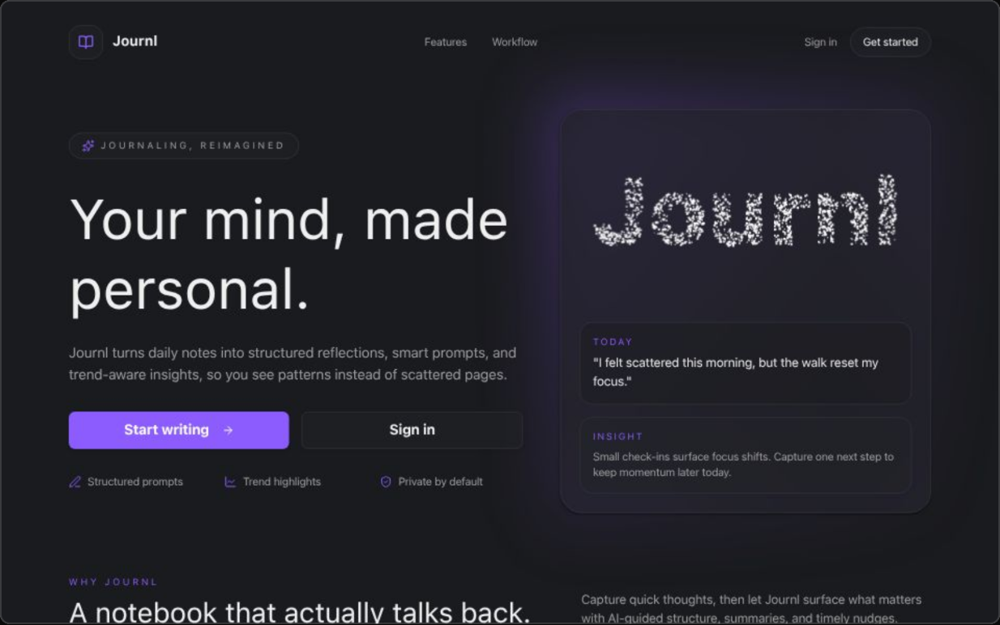

  
  <h1><a href="https://journl-snowy.vercel.app/">Journl</a></h1>

  

  Open source AI-driven journaling app that turns daily writing into structured reflection.

---

## Repository Structure

This is a monorepo powered by [Turborepo](https://turborepo.dev/) and
[pnpm](https://pnpm.io/).

- Workspace layout is defined in [`pnpm-workspace.yaml`](./pnpm-workspace.yaml).
- Shared task pipeline and env wiring live in [`turbo.json`](./turbo.json).

---

## What Lives Here

- **Web app:** [`apps/web`](./apps/web), including marketing pages,
  authenticated journaling views, API routes, and editor UI.
- **Shared packages:** [`packages`](./packages) for auth, database access,
  usage domain logic, the framework-independent [`document contract`](packages/document/README.md),
  the [`BetterEditor engine and React UI`](packages/better-editor/README.md),
  reference previews, shared UI primitives, and compatibility code for the legacy AI integration.
- **Local dev utilities:** [`apps/drizzle-studio`](./apps/drizzle-studio) and
  [`apps/stripe`](./apps/stripe).
- **Agents & Contributor guidance:** [`AGENTS.md`](./AGENTS.md).

---

## Architecture Entry Points

Use these paths as the fastest way to understand the product and core systems.

- **App surfaces:** [`apps/web/src/app`](./apps/web/src/app)
- **Journal experience:** `apps/web/src/app/(app)/journal`
- **API routes:** [`apps/web/src/app/api`](./apps/web/src/app/api)
- **Editor UI:** [`packages/better-editor`](./packages/better-editor), with app sessions and data integration in [`apps/web/src/components/editor`](./apps/web/src/components/editor)
- **AI/workflow logic:** [`apps/web/src/ai`](./apps/web/src/ai) and [`apps/web/src/workflows`](./apps/web/src/workflows)
- **Auth and usage guards:** [`apps/web/src/auth`](./apps/web/src/auth) and [`apps/web/src/usage`](./apps/web/src/usage)
- **DB schema and usage domain:** [`packages/db/src/schema.ts`](./packages/db/src/schema.ts) and [`packages/db/src/usage`](./packages/db/src/usage)

---

## Editor parity inventory

The [editor feature/content inventory](docs/editor-inventory/README.md) records the
installed editor contract, synthetic recovery fixtures, remaining production
uncertainty, and preservation checks for the Tiptap frontend migration on Journl-owned
block documents. Performance benchmarks are outside this migration scope.
Content checks run with `pnpm --filter @acme/document test:unit` and
`pnpm --filter @acme/better-editor test:unit`. The remaining BlockNote compatibility
suite is separate from the current editor's acceptance checks.

## Development Workflow

Use the scripts in [`package.json`](./package.json) as the canonical source for
day-to-day commands.

- Install the toolchain: `mise install` (Node 26 from `mise.toml`, pnpm 12.8.2 from `package.json`).
- Install dependencies: `mise run pnpm-install`
- Start development tasks: `mise run dev`
- Run quality gates: `pnpm check` and `pnpm typecheck`
- Build the workspace: `pnpm build`

The default install uses pnpm's global virtual store. `PNPM_VIRTUAL_STORE_TYPE=project`
selects a project-local store instead; CI uses that layout because the current
Workflow/Turbopack loader cannot transform dependency files in an external store.
This is a loader compatibility limit, not an installation or TypeScript failure.
For app development or builds, reinstall with
`PNPM_VIRTUAL_STORE_TYPE=project pnpm install` and keep that variable set when
running `pnpm dev` or `pnpm build`. The repository default remains global.

Renovate replaces Dependabot version updates. It covers npm workspace packages,
GitHub Actions, Node in `mise.toml`, and pnpm in `devEngines.packageManager`.
Updates stay in one cross-ecosystem group during Monday's 09:00–09:59 window in
`America/New_York`. Renovate polls within that window rather than starting at an
exact minute. Security updates bypass the weekly window. The organization's
Renovate GitHub App covers all repositories, so no Actions runner or bot token
is required. The configuration takes effect after it reaches the default branch.

Environment variables are loaded from a root `.env` file. See
[`turbo.json`](./turbo.json) for shared env names used by tasks.
If your local Postgres instance does not support TLS, set `POSTGRES_SSL_MODE=disable` in `.env` (default `auto` already disables SSL on loopback hosts).

For database workflows, use root scripts (`pnpm db:push`, `pnpm db:studio`) or
the dedicated utility app in [`apps/drizzle-studio`](./apps/drizzle-studio).

Database schema changes live in [`packages/db/src`](./packages/db/src) and are
applied through `pnpm db:push`, which runs Drizzle Kit's schema comparison and
update flow.

Page and journal content saves require the version loaded by the editor. The
version check and write run in one transaction, including the first journal
entry for a date. Versions advance monotonically; retries keep the original
version so a lost response cannot apply a batch twice. Both editors retain local
drafts and pending saves across app navigation and journal row unmounts, warn
before leaving with unsaved changes, and offer retry, draft download, and explicit
conflict recovery. Page titles share the content save queue. A small header icon shows autosave status. A persistent notice identifies offline edits and save failures and offers
recovery at any scroll position and across navigation. Saving resumes on
reconnection; confirmed conflicts always require explicit recovery. Draft recovery keeps exact rich copies before
loading a newer saved version, with read-only viewing/copying and complete JSON
backup downloads. These copies live in the current tab, not durable browser
storage; importing backup files is not yet supported.

Run `pnpm test:browser` to exercise the running Next.js application with
Playwright, including real journal/page editors and save recovery.

Library items use linked sibling ordering. Folder deletion records background
cleanup requests in the Drizzle-defined `folder_deletion_outbox` table within
the deletion transaction. The existing Vercel Workflow handles cleanup; initial
Library reads and the scheduled recovery workflow retry interrupted dispatches.

Tests are colocated with their source modules as `.spec.ts` or `.spec.tsx`;
database suites use `.integration.spec.ts`.

- `pnpm test`: run all unit, UI, database integration, and browser tests.
- `pnpm test:unit`: run unit and UI tests without Docker.
- `pnpm test:integration`: run database integration tests only.

The full suite and integration shortcut require a running Docker-compatible
container runtime, such as Docker Desktop or Colima. They fail if it is unavailable
rather than skipping database tests. Vitest global setup uses Testcontainers to
start PostgreSQL 17 on a random port, passes its connection to the shared fixture
through Vitest's provided context, and stops the container after the run. No
database URL or application environment file is needed locally or in CI.

Each suite uses `src/testing/postgres.ts` to create a unique disposable database,
build its tables from the actual Drizzle definitions, and drop it afterward,
including when setup fails. Select the tables and foreign-key dependencies needed
by the suite; keep queries and transactions real, and mock external providers and
queue dispatch. The unit configuration excludes integration suites. CI runs both
shortcuts in separate jobs, using the same commands as local development without
a separately configured database service. Integration tasks are never cached.

Browser acceptance uses Playwright Test with desktop Chromium and mobile WebKit.
Install browsers once with `pnpm --filter @acme/web exec playwright install --with-deps chromium webkit`,
then run `pnpm test:browser`. It requires Docker, provisions its own disposable
PostgreSQL database from Drizzle definitions, seeds fixture accounts, and signs in
through Better Auth's normal API. It never reads the root `.env` or uses an
application database URL. The runner owns the local server on port 3100 and
refuses to reuse an existing server. Reports and failure traces are ignored artifacts.

`pnpm test` includes browser acceptance as well as unit and database tests; install
its browser dependencies before running it. Unit tests remain Docker-free.

Recurring Explore refresh and folder cleanup recovery jobs remain required
runtime functionality.

---

## License

This project is licensed under the MIT License. See [`LICENSE`](./LICENSE).
